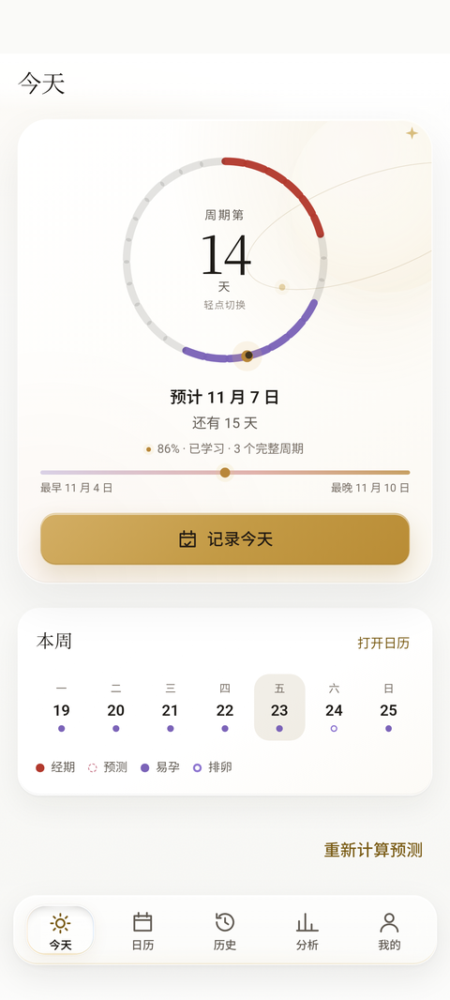
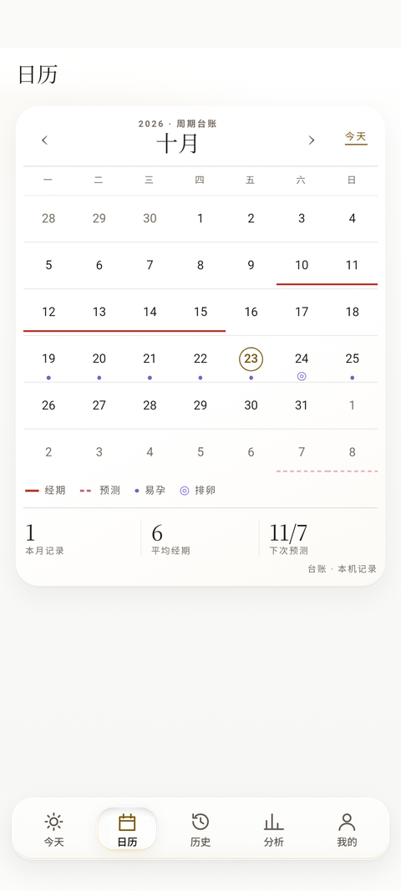
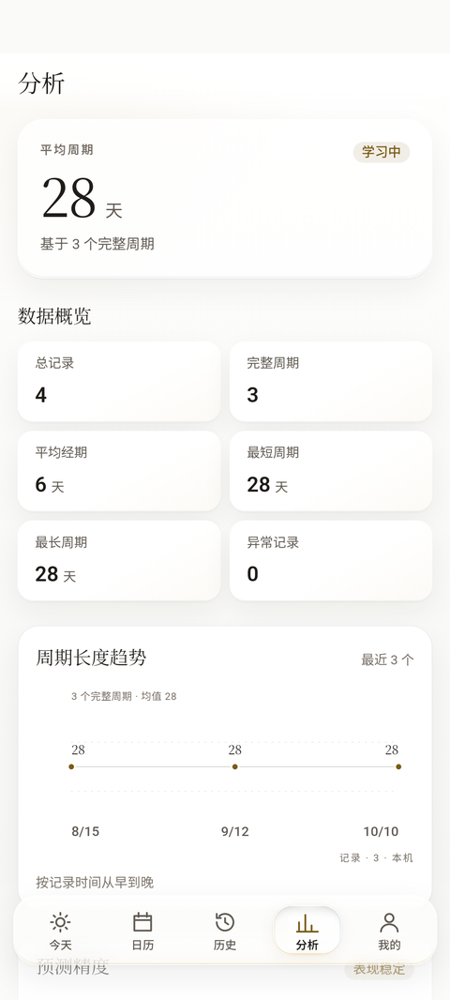
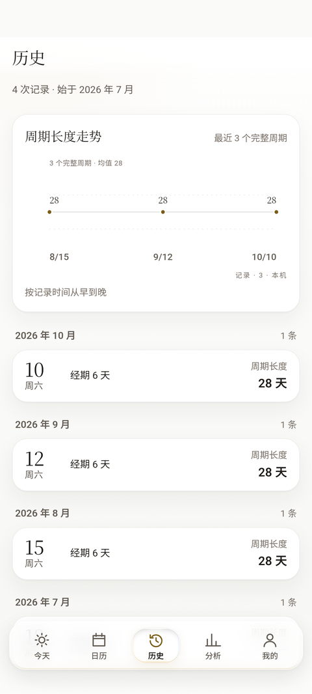
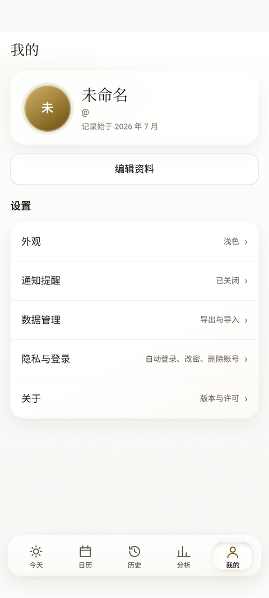
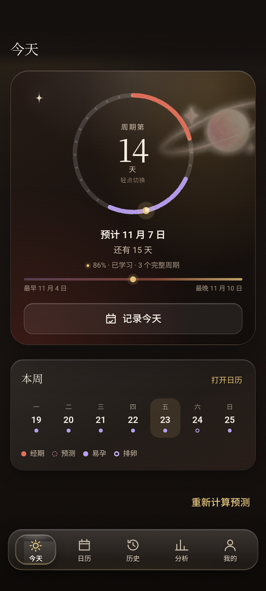

# PeriodIQ

**本地优先的经期记录与预测。没有服务器，没有联网权限，数据只留在你的手机。**

[下载 APK 2.1.0](https://github.com/Yui-0818/PeriodIQ-Android/releases/download/v2.1.0/PeriodIQ-2.1.0.apk) ·
[所有版本](https://github.com/Yui-0818/PeriodIQ-Android/releases) ·
[问题反馈](https://github.com/Yui-0818/PeriodIQ-Android/issues)

> 这是统计推算工具，不是医学诊断，也不能作为避孕依据。

---

## 2.1.0 · 视觉与交互重做

- **白纸底色**：以近白纸色为底、香槟金点缀、衬线标题；浅色默认，深色可选，也可跟随系统。
- **液态玻璃底栏**：底栏是透光玻璃；选中的 tab 是一枚圆角矩形液态玻璃胶囊，带真实折射与轻微放大，完整包住图标与文字。液态玻璃只出现在这里，其余界面是克制的简约玻璃板。
- **今天页**：28 天分段周期环，环心可切换「周期第几天 / 距下次预测」；预测日期、区间与置信度合并在同一张卡里。
- **周期台账日历**：发丝分隔、连续经期线、预测虚线、易孕点与排卵双环；左右滑动切换月份。
- **曲线**：采用 Lupi 编辑语法——发丝线、记录点、直接标注与均值参考；数据少时不再强行画面积图。
- **5 个主 tab，只做竖屏**：今天 / 日历 / 历史 / 分析 / 我的。

---

## 预览

| 今天（浅色） | 日历 | 分析 |
|---|---|---|
|  |  |  |

| 历史 | 我的 | 今天（深色） |
|---|---|---|
|  |  |  |

---

## 能做什么

- **记录**：一次点击记录经期开始；可补结束日与备注，也可在应用内手动补录。
- **日历**：经期、预计经期、易孕窗口与排卵日落在同一张月历上；点提醒可直接回到日历。
- **历史**：按月份分组，展示每次周期长度与走势。
- **分析**：平均周期、平均经期、最短/最长周期、异常记录与预测误差；数据不足时明确显示冷启动。
- **提醒**：提前 N 天（1/2/3/5/7）、当日、逾期提醒；锁屏只显示公开文案。
- **数据**：JSON 完整备份、CSV 周期表导出；导入会替换本机数据，并带异常二次确认。
- **隐私**：自动登录、修改密码、退出登录、删除账号；删除不可撤销。
- **外观**：浅色 / 深色 / 跟随系统；状态栏图标随外观切换。

---

## 隐私

- **不申请 `INTERNET` 权限**：应用没有任何联网能力，也没有统计、广告或崩溃上报 SDK。
- 只申请两个权限：
  - `POST_NOTIFICATIONS`：经期提醒；
  - `RECEIVE_BOOT_COMPLETED`：重启后恢复提醒。
- 数据保存在应用私有目录，`allowBackup="false"`；账号口令使用 PBKDF2-HMAC-SHA256（60 万次迭代）保存。
- 通知设置是设备级偏好，不进入备份。
- **导出/备份文件包含敏感周期数据**，请只保存到自己信任的位置。

---

## 安装

- Android 8.0（API 26）及以上，`arm64-v8a` 设备。
- 仓库只提供一个安装包：[Releases](https://github.com/Yui-0818/PeriodIQ-Android/releases) 中的 `PeriodIQ-2.1.0.apk`。
- 首次安装需允许「安装未知来源应用」。
- 后续版本使用同一签名密钥，可直接覆盖安装并保留数据。

---

## 从源码构建

需要：

- JDK 21
- Android SDK 35（`ANDROID_SDK_ROOT`）
- Python 3.11（Chaquopy 构建期使用）

Windows（PowerShell）：

```powershell
$env:JAVA_HOME = '<JDK 21 路径>'
$env:ANDROID_SDK_ROOT = '<Android SDK 路径>'
$env:PIQ_PYTHON = '<Python 3.11 可执行文件>'
.\gradlew.bat :app:assembleDebug
```

macOS / Linux：

```bash
export JAVA_HOME=/path/to/jdk-21
export ANDROID_SDK_ROOT=/path/to/android-sdk
export PIQ_PYTHON="$(command -v python3.11)"
./gradlew :app:assembleDebug
```

构建会先把 `frontend/` 复制到 `app/src/main/assets/www/`，再打包 WebView 资产；不需要手工复制。
JVM 单测：

```bash
./gradlew :app:testDebugUnitTest
```

发布包由维护者使用仓库外的私有 keystore 签名；仓库不包含任何密钥。

---

## 技术栈

- Kotlin / AndroidX WebKit，targetSdk 35，minSdk 26，固定竖屏。
- WebView + 本地静态前端（原生 HTML/CSS/JS，无框架、无 CDN、无网络请求）。
- Chaquopy 16.1.0 + Python 3.11：周期统计算法。
- SQLite 本地存储；JSON 备份格式与桌面端保持字段一致。
- 纯 SVG 图表；无 Canvas 图表库。

更细的跨端口径与数据格式见 [`docs/契约/跨端契约.md`](docs/契约/跨端契约.md)。

---

## 许可

代码以 **MIT License** 发布，见 [LICENSE](LICENSE)。第三方组件许可见 [NOTICE](NOTICE)。
应用内美术资源为项目原创，随仓库以 MIT 许可提供。

---

## 说明

PeriodIQ 是个人项目，优先保证「数据在自己手里」与「离线可用」。
不提供云同步、账号服务器、广告或数据上传。欢迎 issue，但不会加入需要联网的功能。
